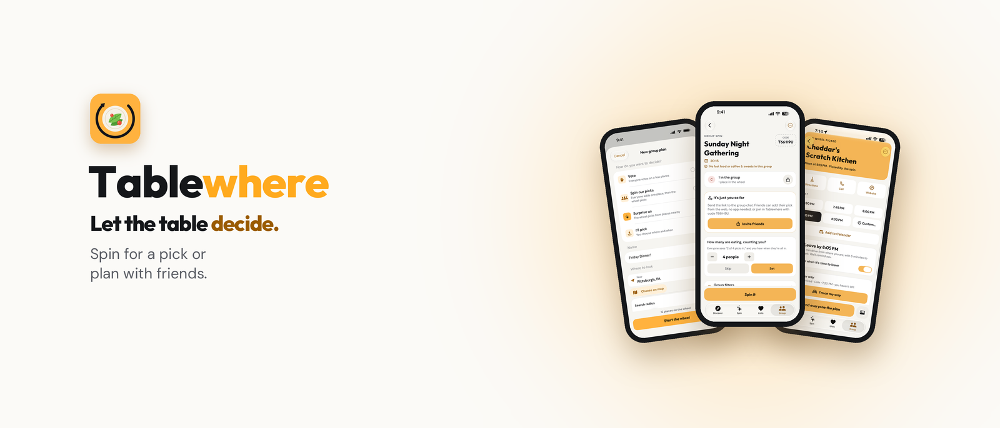
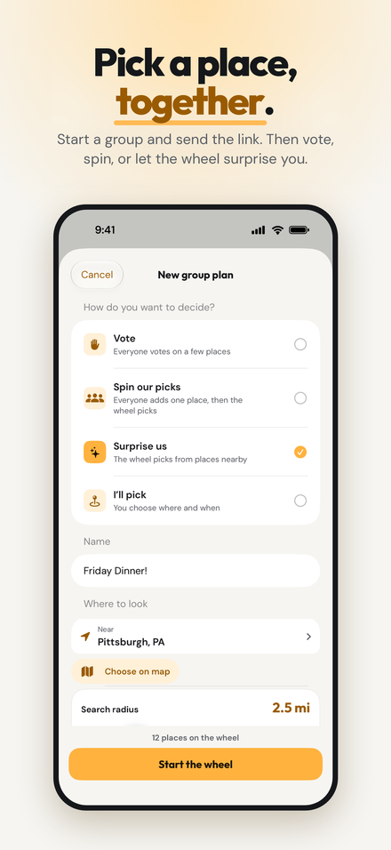
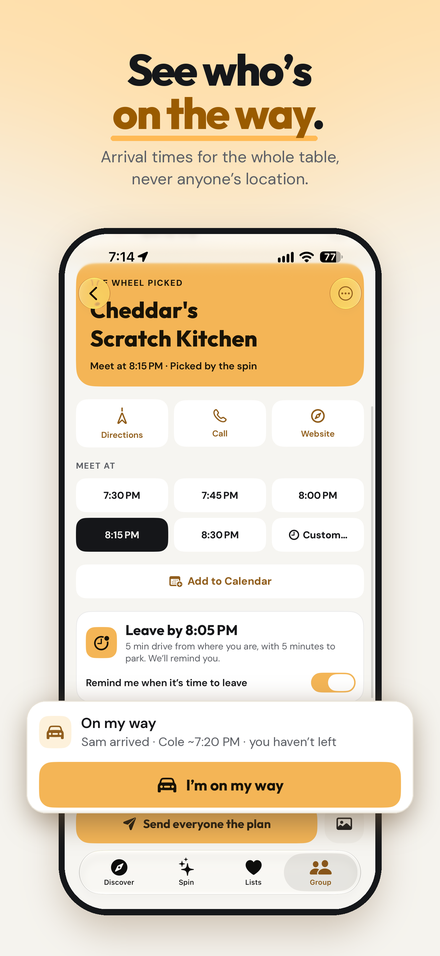
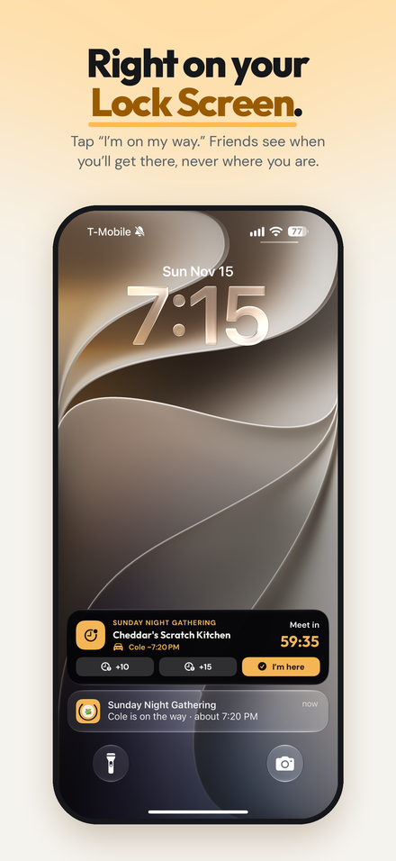
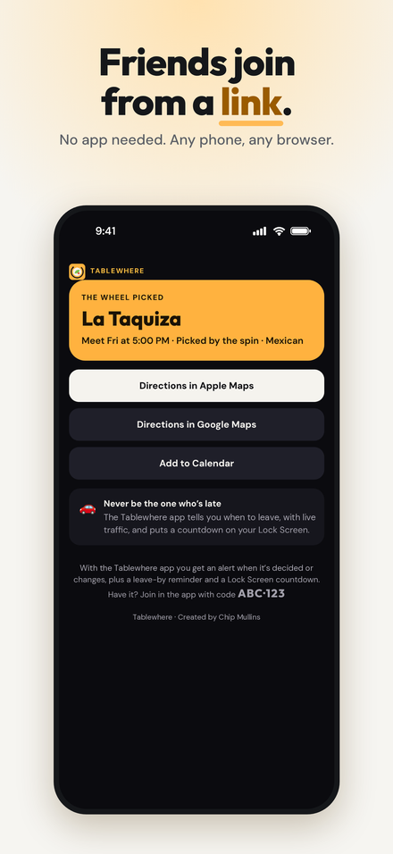

<p align="center">
  
</p>

# Tablewhere

**Let the table decide.** Tablewhere is an iPhone app for the oldest argument there is: where to eat. Spin for a pick nearby, or start a group, send the link, and let everyone vote or add a place. Once there's a plan, it tells you when to leave, counts down on your Lock Screen, and shows the group who's on the way.

I designed, built and shipped it myself. It's live on the App Store and in active development.

## Why I built it

My family could never agree on where to eat. Once we finally picked a place, we'd argue about what time to meet, then about when to leave, and someone always ended up texting "where are you?" from the table. Eventually my mom asked if I could make an app to settle it. This is that app: it takes the family from "I don't care, you pick" to everyone sitting down.

<p align="center">
  
  
  
  
</p>

## What it does

**On your own**
- Browse restaurants nearby on a map, with filters for cuisine, diet, distance and "no fast food"
- Spin for a random pick that skips places you've blacklisted or picked recently
- Spin your own home meals when you're eating in
- Keep lists of favorites, places to try, and places you never want to see again, synced across devices with iCloud
- Plan ahead for a trip by browsing and saving spots in another city

**With a group**
- Four ways to decide: vote, spin everyone's picks, let the wheel choose, or just pick and send the plan
- Friends join from a link in any browser, so nobody needs the app to take part
- Start and vote right inside an iMessage conversation
- Set a meet time, see who's coming, and get alerts when someone votes or it's decided

**Getting there**
- A leave-by reminder based on live traffic
- A Lock Screen countdown (Live Activity) that the server starts ahead of time, with buttons for "On my way", "Running late" and "I'm here"
- Arrival times shared with the group, never anyone's location

## Why it's different

Most "where should we eat" apps stop once a restaurant is picked. Restaurant apps help one person find a place, and group polls settle a vote. After that, the group is back in the text thread asking who's leaving when and who's already there.

Tablewhere covers the whole evening in one place:

1. **Deciding.** Vote, spin everyone's picks, or let the wheel choose, with filters the whole group shares.
2. **Including everyone.** Friends join from a link in any browser, so the one person without the app isn't left out.
3. **Making it a plan.** A meet time, who's coming, and alerts when it's decided.
4. **Getting there.** Leave-by reminders, a Lock Screen countdown that starts on its own, and live arrival times that never reveal anyone's location.

Each piece exists somewhere else on its own. What Tablewhere adds is connecting them, so the group goes from "I don't care, you pick" to everyone sitting down without a single "where are you?" text.

## How it's built

| Part | Stack |
|---|---|
| iPhone app | Swift, SwiftUI, SwiftData + CloudKit, MapKit, ActivityKit, WidgetKit, App Intents |
| iMessage app | Messages framework, sharing code with the main app |
| Shared logic | A Swift package (`PickerCore`) with no UI or network code, covered by unit tests |
| Backend | Firebase: Firestore, anonymous Auth, Cloud Functions (TypeScript), Hosting |
| Web | Plain JavaScript and MapKit JS for the join-by-link page, tested with Playwright |
| Push | APNs, sent straight from Cloud Functions with a signed JWT for Live Activity updates |

The project file is generated from `project.yml` with XcodeGen, so targets, entitlements and settings live in one readable file instead of in Xcode's project format.

## Problems worth mentioning

**Group decisions that every device agrees on.** Ties and spins are settled by a random pick seeded with the session ID. Every phone and browser gets the same answer without asking a server to referee.

**Security without accounts.** Nobody signs up. Everyone gets an anonymous Firebase identity, and the Firestore rules do the rest. Anyone with the link can see a session, but nobody can list sessions. You can only change your own vote, and only while voting is open. Only the creator can lock in a result. Device tokens are readable only by their owner, and arrival times only by people in the plan.

**Lock Screen countdowns that start themselves.** iOS only lets an app start a Live Activity while it's open, which doesn't help when dinner is in three hours. The app registers a push-to-start token, and a scheduled Cloud Function starts the countdown at the right time for each person, keeps it updated as friends leave or arrive, and ends it when everyone's there.

**Sharing ETAs without sharing location.** "On my way" tracks location on the phone only, works out the drive time, and shares just the estimated arrival time. Updates go out only when that time moves by two minutes or more, which keeps both battery use and database writes down.

**One source of truth for food filters.** The cuisine, diet and fast-food lists live in Swift. A small Node script generates the same lists for the web page, and a test fails if the two ever drift apart.

**Privacy by default.** The only analytics are anonymous daily totals, like the number of spins, with no names, places or device IDs. They're viewable on a private admin page and can be turned off in Settings.

## Repository layout

```
ForkRoad/              iPhone app (features, models, services)
MessagesExtension/     iMessage app
ForkRoadWidgets/       Home Screen widget and Lock Screen Live Activity
Shared/                Code shared by the app, iMessage app and widgets
Packages/PickerCore/   Pure logic and unit tests: spins, tallies, filters, arrivals
web/                   Firebase Hosting site, Firestore rules, Cloud Functions, Playwright tests
Design/                App icon source art
```

The app was called ForkRoad early on, and the code still uses that name. Renaming bundle IDs, the iCloud container or the Firebase project would break existing installs, so only the public name changed.

## Tests

```sh
(cd Packages/PickerCore && swift test)   # app logic
node web/tests/run.mjs                   # web page, in a headless browser (needs Playwright)
node web/tools/test-food-filters.mjs     # Swift and web filter lists match
```

## Running it yourself

You'll need a Mac with Xcode, XcodeGen, and your own Firebase project. [docs/SETUP.md](docs/SETUP.md) covers each step.

---

Built by Chip Mullins.
